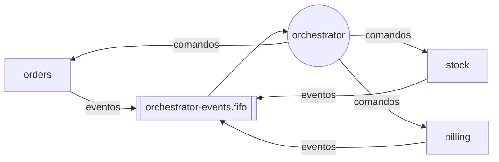
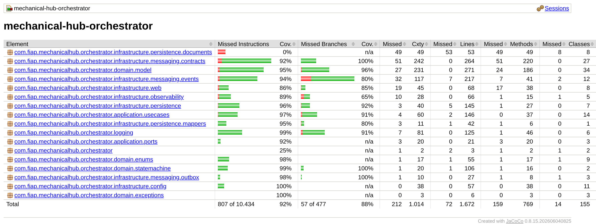

# mechanical-hub-orchestrator

Orquestrador da saga de ordens de serviço do Mechanical Hub: guarda o estado de uma saga por ordem, consome os eventos de `orders`, `stock` e `billing`, decide o próximo passo e publica o comando de cada serviço, conduzindo também as compensações.
Kotlin, Java 25, Spring Boot 4.1, MongoDB 7 (replica set), Amazon SQS FIFO, ShedLock, Cucumber.

[](https://github.com/mechanical-hub-fiap/mechanical-hub-orchestrator/actions/workflows/deploy.yml) [](https://sonarcloud.io/summary/new_code?id=mechanical-hub-orchestrator) [](https://sonarcloud.io/summary/new_code?id=mechanical-hub-orchestrator)

## Responsabilidade

- **Faz:** cria e mantém a saga de cada ordem, aplica a guarda de passo, publica os comandos via outbox, conduz as compensações e guarda a trilha completa de cada saga. Hospeda o BDD do fluxo completo.
- **Não faz:** regra de negócio da ordem, do estoque ou do pagamento (cada serviço valida o próprio passo), API para mecânico ou cliente, notificações, chamadas REST aos outros serviços.
- **Fora do escopo por enquanto:** prazo para `AWAITING_STOCK` e compensação automática de sagas paradas (FR-01), ajuste de reparos ou orçamento depois do início da saga (FR-02+). Detalhes em [Decisões e limitações](docs/mechanical-hub-orchestrator-architecture-spec.md#9-decisões-e-limitações).

## Papel na saga



O orquestrador é disparado por cada evento dos três serviços. Ele confere se a saga está no passo esperado, avança o passo e responde com o comando seguinte, tudo numa única transação no MongoDB (saga + histórico + outbox). Evento fora do passo é descartado e registrado. Estratégia: [RFC-0005](docs/rfc/RFC-0005-saga-orquestrada.md) / [ADR-0005](docs/adr/ADR-0005-divisao-em-microsservicos.md).

| Evento | Passo esperado | Próximo passo / status | Publica |
|---|---|---|---|
| `diagnosisCompleted` | — (cria a saga) | `RESERVE_STOCK` · `STARTED` | `reserveStock` |
| `stockPending` | `RESERVE_STOCK` | `AWAITING_STOCK` | `markStockPending` |
| `stockReserved` | `RESERVE_STOCK` / `AWAITING_STOCK` | `GENERATE_BUDGET` | `generateBudget` (+ `clearStockPending` se vinha de `AWAITING_STOCK`) |
| `budgetGenerated` | `GENERATE_BUDGET` | `WAITING_APPROVAL` | `sendApproval` |
| `orderApproved` | `WAITING_APPROVAL` | `AWAITING_PAYMENT` | `generatePaymentLink` |
| `orderRejected` | `WAITING_APPROVAL` | `RESTORE_STOCK` · `COMPENSATING` | `restoreStock` |
| `paymentLinkGenerated` | `AWAITING_PAYMENT` | — (grava o link) | `sendPaymentLink` |
| `paymentConfirmed` | `AWAITING_PAYMENT` | `AWAITING_EXECUTION` | `releaseOrder` |
| `paymentFailed` | `AWAITING_PAYMENT` | `CANCEL_ORDER` · `COMPENSATING` | `cancelOrder` |
| `orderCanceled` | `CANCEL_ORDER` | `RESTORE_STOCK` | `restoreStock` |
| `orderFinished` | `AWAITING_EXECUTION` | `CONSUME_STOCK` | `consumeStock` |
| `stockConsumed` | `CONSUME_STOCK` | fim · `COMPLETED` | — |
| `stockRestored` | `RESTORE_STOCK` | fim · `COMPENSATED` | — |

## Stack

| Linguagem/framework | Banco | Mensageria | Testes | Qualidade | Observabilidade |
|---|---|---|---|---|---|
| Kotlin, Java 25, Spring Boot 4.1 | MongoDB 7 | Amazon SQS FIFO | JUnit, Testcontainers, Cucumber | JaCoCo, ktlint, detekt, SonarQube Cloud | OpenTelemetry, Prometheus, Grafana |

## Como rodar

- **Pré-requisitos:** JDK 25 e Docker.
- **Dependências locais:** o profile `local` sobe pelo `compose.yaml` o MongoDB (`rs0`, porta 27017) e o LocalStack (4566, as 4 filas FIFO + DLQs).
- **Variáveis de ambiente:** [`.env.example`](.env.example); sem chave AWS (na nuvem os pods usam a `LabRole`).
- **Rodar e verificar:**

```bash
./mvnw spring-boot:run -Dspring-boot.run.profiles=local
curl -s http://localhost:8080/actuator/health        # {"status":"UP"}
```

Para simular os outros serviços, envie eventos direto à fila do LocalStack (`awslocal sqs send-message` em `mechanical-hub-orchestrator-events.fifo`) e acompanhe com `GET /transaction/{orderId}`.

## API

| Método | Rota | Descrição |
|---|---|---|
| GET | `/transaction/{orderId}` | Saga + histórico da ordem (depuração; fora do API Gateway) |
| GET | `/actuator/health/*`, `/actuator/prometheus` | Probes e métricas |

Não expõe API de negócio. Detalhes em [Interface síncrona](docs/mechanical-hub-orchestrator-architecture-spec.md#4-interface-síncrona-rest).

## Mensagens

- **Consome:** `diagnosisCompleted`, `stockPending`, `stockReserved`, `budgetGenerated`, `orderApproved`, `orderRejected`, `paymentLinkGenerated`, `paymentConfirmed`, `paymentFailed`, `orderCanceled`, `orderFinished`, `stockConsumed`, `stockRestored`.
- **Publica:** `reserveStock`, `markStockPending`, `clearStockPending`, `generateBudget`, `sendApproval`, `generatePaymentLink`, `sendPaymentLink`, `releaseOrder`, `cancelOrder`, `consumeStock`, `restoreStock`.
- Contratos, filas e idempotência: [Interface assíncrona](docs/mechanical-hub-orchestrator-architecture-spec.md#5-interface-assíncrona-mensagens).

## Dados

MongoDB, porque cada saga é um documento que cresce a cada passo e as transações multi-documento garantem saga + histórico + outbox atômicos. Detalhes em [Modelo de dados](docs/mechanical-hub-orchestrator-architecture-spec.md#6-modelo-de-dados).

## Testes e cobertura

```bash
./mvnw verify   # unitários, integração (Testcontainers: MongoDB + LocalStack), BDD Cucumber, ktlint, detekt e jacoco:check
```



Relatório JaCoCo da última execução completa de `verify` (2026-11-02): **95,7% de linhas** e 88,1% de branches. Meta: ≥ 80% (o build falha abaixo disso). O BDD (`src/test/resources/features/saga.feature`) cobre caminho feliz, pendência de estoque, orçamento recusado, pagamento não confirmado, duplicatas e mensagens fora de ordem; relatório em `target/cucumber-report/cucumber.html`.

## CI/CD

Build → testes (unitários, integração e BDD) → SonarQube Cloud (quality gate) → imagem no ECR → deploy no EKS → smoke test (health, MongoDB e sonda SQS). Workflow: [`deploy.yml`](.github/workflows/deploy.yml); executado também pela pipeline única [`deploy-all.yml`](https://github.com/mechanical-hub-fiap/mechanical-hub-infra/blob/main/.github/workflows/deploy-all.yml) do `mechanical-hub-infra`.

## Observabilidade

Logs JSON com `orderId`, `status`/`stage`, `transactionId` e `currentStep`; métricas `saga_*` e `outbox_oldest_pending_age_seconds` no Prometheus; traces OpenTelemetry propagados pelo SQS. Padrão: [logging-standard](docs/engineering/logging-standard.md).

## Documentação

- Arquitetura deste serviço: [`docs/mechanical-hub-orchestrator-architecture-spec.md`](docs/mechanical-hub-orchestrator-architecture-spec.md)
- Documentação do sistema: [diagrama](https://github.com/mechanical-hub-fiap/mechanical-hub-orchestrator/blob/main/docs/architecture/mechanicalHubFase4Diagrama-v2.png) · [saga](https://github.com/mechanical-hub-fiap/mechanical-hub-orchestrator/blob/main/docs/design/saga_transaction_status.md) · [ADRs](https://github.com/mechanical-hub-fiap/mechanical-hub-orchestrator/tree/main/docs/adr) · [RFCs](https://github.com/mechanical-hub-fiap/mechanical-hub-orchestrator/tree/main/docs/rfc) · [TDs](https://github.com/mechanical-hub-fiap/mechanical-hub-orchestrator/tree/main/docs/design/distributedTransaction) · [data model](https://github.com/mechanical-hub-fiap/mechanical-hub-orchestrator/blob/main/docs/design/data_model.md)
- Outros serviços: [mechanical-hub-orders](https://github.com/mechanical-hub-fiap/mechanical-hub-orders) · [mechanical-hub-stock](https://github.com/mechanical-hub-fiap/mechanical-hub-stock) · [mechanical-hub-billing](https://github.com/mechanical-hub-fiap/mechanical-hub-billing)
