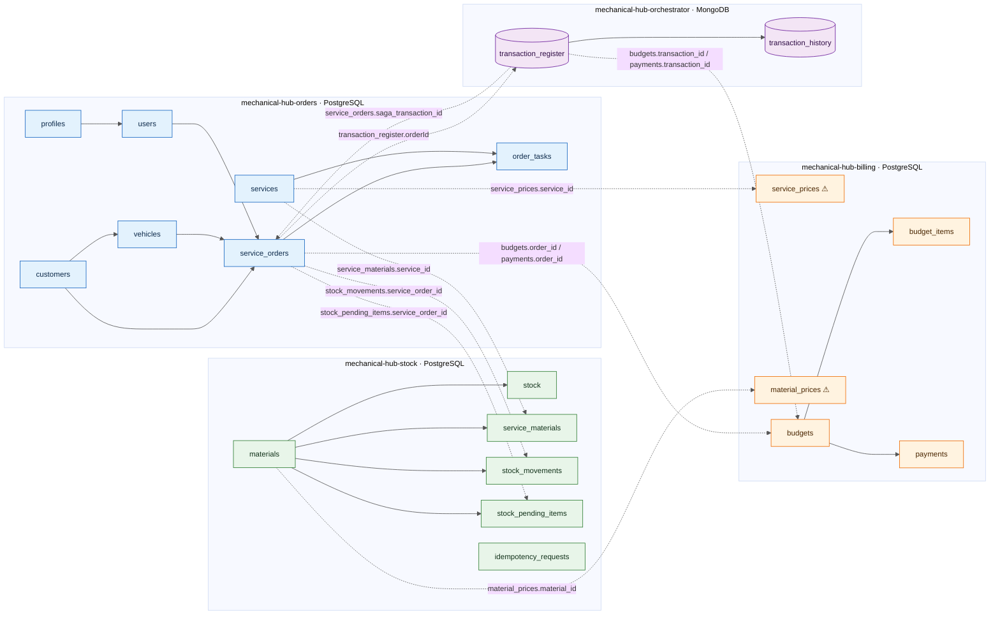
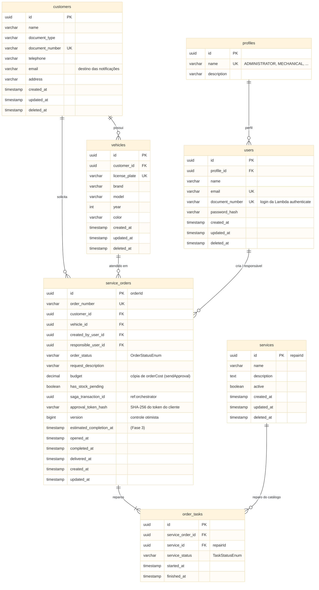
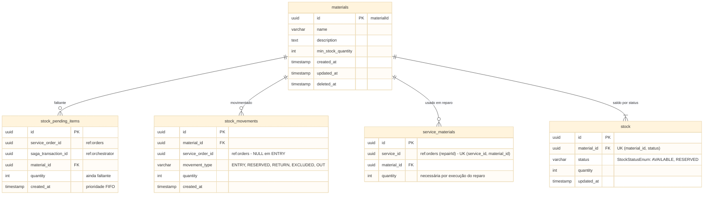
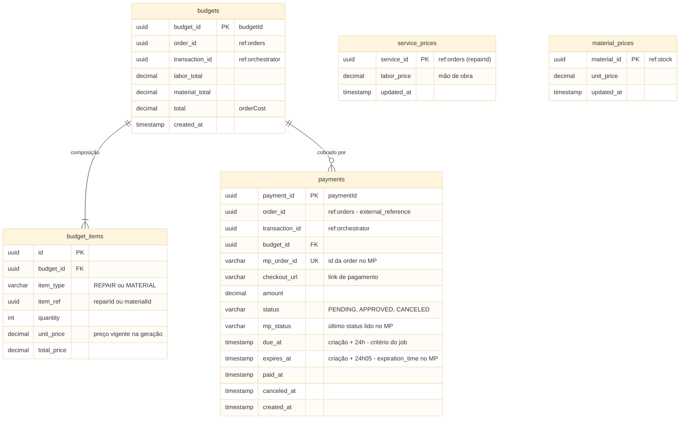
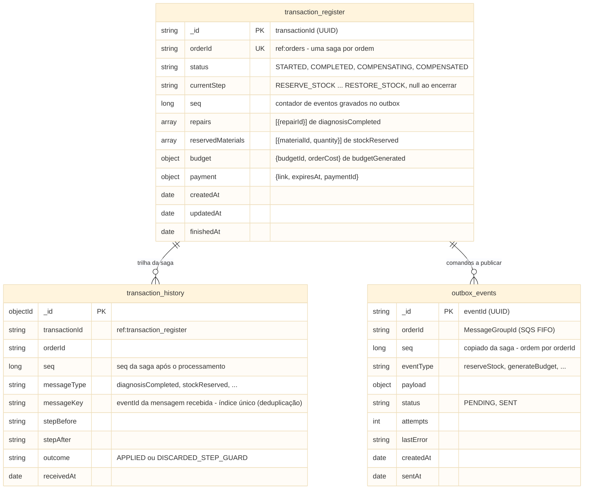
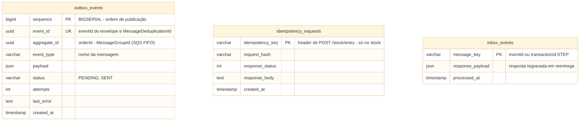

# Mechanical Hub — Modelagem de Dados por Serviço (Fase 4)

> Disposição das entidades de cada microsserviço **derivada dos fluxos de transação já definidos** ([`td_finished_os.md`](distributedTransaction/td_finished_os.md), [`td_stock_pending.md`](distributedTransaction/td_stock_pending.md), [`td_budget_refused.md`](distributedTransaction/td_budget_refused.md), [`td_payment_failed.md`](distributedTransaction/td_payment_failed.md), [`mp_payment_api_integration.md`](integrations/mp_payment_api_integration.md)) e das tabelas da Fase 3 (`mechanical-hub/src/main/resources/db/migration`).
>
> Mostra quais entidades cada serviço possui, seus atributos e como os serviços se referenciam. A tecnologia de banco de cada serviço está definida na [ADR-0004](../adr/ADR-0004-banco-de-dados-por-microsservico.md): **PostgreSQL** em `orders`, `stock` e `billing` (tabelas) e **MongoDB** em `orchestrator` (coleções de documentos). Os pontos marcados com ⚠ e as pendências da seção 8 ainda estão em aberto.

## Legenda

| Marcação | Significado |
|---|---|
| `PK` / `FK` / `UK` | Chave primária / chave estrangeira **dentro do mesmo serviço** / restrição de unicidade |
| `ref:<serviço>` | Identificador de entidade de **outro** serviço: sem FK, chega por mensagem SQS ou requisição REST |
| ⚠ | Atributo ou entidade citado nos TDs sem definição completa (nome, colunas ou forma) |
| *(Fase 3)* | Coluna herdada do modelo atual, sem uso nos fluxos da Fase 4 |
| `object` / `array` | Subdocumento / lista embutida no documento (somente MongoDB, seção 5) |

---

## 1. Visão geral — disposição das entidades e referências entre serviços

Linha contínua = FK (ou, no MongoDB, referência por ID) dentro do serviço. Linha pontilhada = referência lógica entre serviços (somente o ID, sem FK). Nós cilíndricos = coleções MongoDB; nós retangulares = tabelas PostgreSQL.



Além das tabelas e coleções acima, **cada um dos quatro serviços** tem a própria `outbox_events`, e orders, stock e billing têm a própria `inbox_events` (seção 6), omitidos do diagrama para não poluí-lo.

### Quem é dono de cada identificador que cruza fronteiras

| Identificador | Dono (origem) | Onde aparece fora do dono | Como chega |
|---|---|---|---|
| `orderId` (`service_orders.id`) | orders | stock (`stock_movements`, `stock_pending_items`), billing (`budgets`, `payments`), orchestrator (`transaction_register`) | Payload de toda mensagem da saga; key de partição |
| `repairId` (`services.id`) | orders ⚠ | stock (`service_materials.service_id`), billing (preço de mão de obra), orchestrator (`transaction_register.repairs`) | `diagnosisCompleted` → `reserveStock` / `generateBudget` |
| `materialId` (`materials.id`) | stock | billing (preço unitário, `budget_items`), orchestrator (`transaction_register.reservedMaterials`) | `stockReserved` → `generateBudget` / `consumeStock` / `restoreStock` |
| `transactionId` | orchestrator | orders (`saga_transaction_id`), stock (`stock_pending_items.saga_transaction_id`), billing (`budgets`, `payments`) | Payload de todo comando do orquestrador |
| `budgetId` | billing | orchestrator (`transaction_register.budget.budgetId`) | `budgetGenerated` |
| `paymentId` | billing | orchestrator (`transaction_register.payment.paymentId`) | `paymentConfirmed` |
| `mp_order_id` | Mercado Pago | billing (`payments`) | Resposta de `POST /v1/orders` |

---

## 2. `mechanical-hub-orders` — PostgreSQL

Dono da ordem de serviço, do seu status, dos reparos da ordem e dos cadastros que a interface com mecânicos usa (cliente, veículo, funcionário, catálogo de reparos).



Mudanças em relação à Fase 3:

| Entidade | Mudança | Origem da decisão |
|---|---|---|
| `services` | Sai `base_price`, `labor_cost`, `total_price` (preço é do billing) | Dono do preço = billing |
| `service_orders` | Entram `saga_transaction_id`, `approval_token_hash`, `version` | td_finished_os §0.1, passos 11–12 |
| `materials`, `stock`, `service_materials`, `stock_movements`, `stock_pending_items` | Saem do banco de orders | Dono do estoque = stock |

---

## 3. `mechanical-hub-stock` — PostgreSQL

Dono dos materiais, da relação serviço↔material e das quantidades. Não conhece preço.



Mudanças em relação à Fase 3:

| Entidade | Mudança | Origem da decisão |
|---|---|---|
| `materials` | Sai `unit_price` | Dono do preço = billing |
| `service_materials` | `service_id` deixa de ser FK (o reparo é de orders) | Data ownership |
| `stock_movements`, `stock_pending_items` | `service_order_id` deixa de ser FK | Data ownership |
| `stock_pending_items` | Entra `saga_transaction_id` | td_stock_pending §2 |
| `stock` | Unicidade `(material_id, status)` — "uma linha por material + status" | td_finished_os §0.1 |
| `idempotency_requests` | Nova (tabela de controle, detalhada na seção 6) | td_stock_pending P4 |

---

## 4. `mechanical-hub-billing` — PostgreSQL

Dono dos preços, dos orçamentos (histórico) e dos pagamentos (integração com o Mercado Pago).



Notas:

- `service_prices` / `material_prices` ⚠: os TDs falam em "catálogo de preços" (mão de obra por `repairId`, unitário por `materialId`) sem nome nem forma. As duas tabelas acima são só uma forma de visualizar; a modelagem é uma das definições pendentes.
- `budget_items` ⚠: os TDs dizem apenas "uma linha por reparo e por material, com preço vigente no momento"; as colunas são a leitura mais direta dessa frase.
- `payments` segue a **Orders API** do Mercado Pago (`td_finished_os.md` passos 14 e 17, `td_payment_failed.md`).

---

## 5. `mechanical-hub-orchestrator` — MongoDB

Dono do estado de cada saga. Uma saga por ordem. Os campos usam camelCase, convenção do MongoDB/Spring Data, e são os mesmos usados nas operações do orquestrador nos TDs (`td_finished_os.md` 0.4).



Exemplo de documento em `transaction_register` (saga aguardando pagamento):

```json
{
  "_id": "6f2c1d0e-8a4b-4c1e-9d3f-1b2a3c4d5e6f",
  "orderId": "a1b2c3d4-0000-4000-8000-000000000001",
  "status": "STARTED",
  "currentStep": "AWAITING_PAYMENT",
  "seq": 5,
  "repairs": [
    { "repairId": "r-oil-change" },
    { "repairId": "r-brake-pads" }
  ],
  "reservedMaterials": [
    { "materialId": "m-oil-5w30", "quantity": 4 },
    { "materialId": "m-brake-pad", "quantity": 2 }
  ],
  "budget": { "budgetId": "b-123", "orderCost": 350.00 },
  "payment": { "link": "https://www.mercadopago.com.br/checkout/...", "expiresAt": "2026-10-07T12:05:00Z", "paymentId": null },
  "createdAt": "2026-10-06T10:00:00Z",
  "updatedAt": "2026-10-06T12:00:00Z",
  "finishedAt": null
}
```

### Índices

| Coleção | Índice | Uso |
|---|---|---|
| `transaction_register` | `{ orderId: 1 }` **único** | Uma saga por ordem (substitui `UNIQUE (order_id)`) |
| `transaction_register` | `{ status: 1, currentStep: 1, updatedAt: 1 }` | Localizar sagas paradas (ex.: em `AWAITING_PAYMENT` há mais de 2 dias) |
| `transaction_history` | `{ messageKey: 1 }` **único** | Deduplicação das mensagens recebidas (substitui `inbox_events` no orquestrador) |
| `transaction_history` | `{ orderId: 1, seq: 1 }` | Trilha de uma ordem em sequência |
| `transaction_history` | `{ messageType: 1, receivedAt: 1 }` | Agregações por passo e período |
| `outbox_events` | `{ status: 1, createdAt: 1 }` | Seleção do relay |
| `outbox_events` | `{ orderId: 1, seq: 1 }` **único** | Ordem de publicação por ordem de serviço |

### Como os mecanismos dos TDs ficam no MongoDB

| Mecanismo (TDs) | PostgreSQL (orders, stock, billing) | MongoDB (orchestrator) |
|---|---|---|
| Uma saga por ordem | `UNIQUE (order_id)` | Índice único em `orderId`; erro de chave duplicada → descarta a mensagem (`DeleteMessage`) |
| Guarda de passo | `UPDATE ... WHERE <status> = :esperado` (ex.: transições da ordem e do pagamento) | `findOneAndUpdate({ _id, currentStep: esperado }, { $set: ..., $inc: { seq: n } })`, com n = nº de eventos gravados no outbox na transação; `null` → mensagem descartada |
| Alteração + outbox atômicos | Mesma transação local | Transação multi-documento: `transaction_register` + `transaction_history` + `outbox_events` |
| Ordem do outbox | `BIGSERIAL sequence` | `seq` por saga (incrementado na guarda de passo pelo nº de eventos gravados; cada evento recebe um valor da faixa reservada); o relay não publica `seq` n+1 de um `orderId` enquanto o n estiver `PENDING` |
| Liderança do relay | `pg_try_advisory_lock` | Lock com expiração (*lease*) em uma coleção de locks (ex.: ShedLock com provider Mongo) |
| Deduplicação | `inbox_events` (PK `message_key`) | `transaction_history` com índice único em `messageKey` |
| Retenção | Job diário em `inbox_events`; `outbox_events` permanente | Sem limpeza: `outbox_events` e `transaction_history` permanentes |

Operações passo a passo em `td_finished_os.md` 0.2–0.4. Pré-requisitos (ADR-0004): replica set em todos os ambientes, `writeConcern: majority`, `readConcern: majority` (transações em `snapshot`), leitura no primário e `MongoTransactionManager` declarado no Spring.

---

## 6. Tabelas de controle

`outbox_events` existe no banco de cada um dos quatro serviços; `inbox_events` existe em orders, stock e billing (no orchestrator, a deduplicação é feita pela `transaction_history`, seção 5). Nenhuma é compartilhada. O diagrama abaixo é a versão **PostgreSQL** (orders, stock, billing); no orchestrator, `outbox_events` é a coleção da seção 5. `idempotency_requests` existe só no stock.



| Tabela | orders | stock | billing | orchestrator | Retenção |
|---|:-:|:-:|:-:|:-:|---|
| `outbox_events` | ✓ | ✓ | ✓ | ✓ (coleção) | Permanente (enviados ficam com status `SENT`, sem exclusão) |
| `inbox_events` | ✓ | ✓ | ✓ | — (deduplicação pela `transaction_history`) | > 30 dias (job diário) |
| `transaction_history` | — | — | — | ✓ (coleção) | Permanente |
| `idempotency_requests` | — | ✓ | — | — | > 7 dias |

---

## 7. Escrita por passo da transação

Quais tabelas/coleções cada passo grava, por serviço (I = insert, U = update, D = delete). Toda linha é uma única transação local (no orchestrator, transação multi-documento). Toda escrita do orchestrator em `transaction_register` também insere um documento em `transaction_history`, omitido das tabelas abaixo.

### 7.1 Caminho feliz (`td_finished_os.md`)

| Passo | Gatilho | Serviço | Tabelas gravadas |
|---|---|---|---|
| 1–3 | REST (mecânico) | orders | `service_orders` I/U · `order_tasks` I |
| 4 | REST — finaliza diagnóstico | orders | `service_orders` U · `outbox_events` I (`diagnosisCompleted`) |
| 6 | `diagnosisCompleted` | orchestrator | `transaction_register` I · `outbox_events` I (`reserveStock`) |
| 7 | `reserveStock` | stock | `inbox_events` I · `stock` U/I (AVAILABLE→RESERVED) · `stock_movements` I (`RESERVED`) · `outbox_events` I (`stockReserved`) |
| 8 | `stockReserved` | orchestrator | `transaction_register` U · `outbox_events` I (`generateBudget`) |
| 9 | `generateBudget` | billing | `inbox_events` I · `budgets` I · `budget_items` I · `outbox_events` I (`budgetGenerated`) |
| 10 | `budgetGenerated` | orchestrator | `transaction_register` U · `outbox_events` I (`sendApproval`) |
| 11 | `sendApproval` | orders | `inbox_events` I · `service_orders` U (status, budget, token, transação) |
| 12 | REST — cliente aprova | orders | `service_orders` U · `outbox_events` I (`orderApproved`) |
| 13 | `orderApproved` | orchestrator | `transaction_register` U · `outbox_events` I (`generatePaymentLink`) |
| 14 | `generatePaymentLink` | billing | `inbox_events` I · `payments` I · `outbox_events` I (`paymentLinkGenerated`) |
| 15 | `paymentLinkGenerated` / `sendPaymentLink` | orchestrator / orders | `transaction_register` U / `service_orders` U (+ `inbox_events`, `outbox_events`) |
| 17 | Webhook MP | billing | `payments` U · `outbox_events` I (`paymentConfirmed`) |
| 18 | `paymentConfirmed` / `releaseOrder` | orchestrator / orders | `transaction_register` U / `service_orders` U |
| 19–20 | REST — execução e finalização | orders | `service_orders` U · `order_tasks` U · `outbox_events` I (`orderFinished`) |
| 21 | `orderFinished` | orchestrator | `transaction_register` U · `outbox_events` I (`consumeStock`) |
| 22 | `consumeStock` | stock | `stock` U (RESERVED −) · `stock_movements` I (`OUT`) · `outbox_events` I (`stockConsumed`) |
| 23 | `stockConsumed` | orchestrator | `transaction_register` U (`COMPLETED`) |
| 24 | REST — entrega | orders | `service_orders` U |

### 7.2 Exceções

| Fluxo | Passo | Serviço | Tabelas gravadas |
|---|---|---|---|
| Pendência | P1 `reserveStock` sem saldo | stock | `stock` U · `stock_movements` I · `stock_pending_items` I · `outbox_events` I (`stockPending`) |
| Pendência | P2 / P3 | orchestrator / orders | `transaction_register` U (`AWAITING_STOCK`) / `service_orders` U (`has_stock_pending = true`) |
| Pendência | P4 `POST /stock/entry` | stock | `idempotency_requests` I/U · `stock` U/I · `stock_movements` I (`ENTRY`, `RESERVED`) · `stock_pending_items` U/D · `outbox_events` I (`stockReserved`, 0..n ordens) |
| Pendência | P5 / P6 | orchestrator / orders | `transaction_register` U / `service_orders` U (`has_stock_pending = false`) |
| Recusa | R1 REST — cliente recusa | orders | `service_orders` U · `outbox_events` I (`orderRejected`) |
| Recusa / pagamento | R3 · F7 `restoreStock` | stock | `stock` U (RESERVED→AVAILABLE) · `stock_movements` I (`RETURN`, `RESERVED`) · `stock_pending_items` U/D · `outbox_events` I (`stockRestored`, `stockReserved` de outras ordens) |
| Pagamento | F3 / F3′ job de expiração | billing | `payments` U (`CANCELED` / `APPROVED`) · `outbox_events` I (`paymentFailed` / `paymentConfirmed`) |
| Pagamento | F5 `cancelOrder` | orders | `service_orders` U (`CANCELED`) · `outbox_events` I (`orderCanceled`) |
| Ambos | R2/R4 · F4/F6/F8 | orchestrator | `transaction_register` U (`COMPENSATING` → `COMPENSATED`) |

### 7.3 Padrão de acesso por serviço (resumo)

| Serviço | Leituras principais | Escritas | Mecanismos de banco que os TDs assumem |
|---|---|---|---|
| orders | Ordem por `id` / `order_number`; listas por status, cliente, responsável; joins ordem↔cliente↔veículo↔reparos | Transições de status com `version`; cadastros | FK entre cadastros; controle otimista; transação local com outbox |
| stock | `service_materials` por lista de `service_id`; `stock` por `material_id + status`; pendências por `material_id` ordenadas por `created_at` | Débito/crédito de saldo concorrente | `SELECT ... FOR UPDATE`; `pg_advisory_xact_lock` por ordem; transação envolvendo várias linhas e tabelas |
| billing | Preço por `repairId` / `materialId`; `payments` por `transaction_id`, `order_id`, `status + due_at` | Orçamento como documento imutável; pagamento com transição condicional | `FOR UPDATE` em `payments`; `pg_try_advisory_lock` (líder do job) |
| orchestrator | Saga por `orderId` (sempre o documento inteiro); histórico por `orderId` e por tipo de mensagem | Atualização do estado da saga a cada mensagem; histórico append-only | Índice único; `findOneAndUpdate` condicional; transação multi-documento saga + histórico + outbox; índice único em `messageKey` (deduplicação) |

Os três serviços PostgreSQL também usam `BIGSERIAL` para ordenar o outbox e `pg_try_advisory_lock` para a liderança do relay; no orchestrator esses papéis ficam com o `seq` da saga e o lock com expiração (seção 5).

---

## 8. Pontos em aberto

### Resolvidos pela ADR-0004

| Pergunta | Decisão |
|---|---|
| Qual serviço usa NoSQL (requisito 1 SQL + 1 NoSQL) | `orchestrator` em MongoDB; `orders`, `stock` e `billing` em PostgreSQL 16 |
| Listas em `transaction_register` | Embutidas no documento da saga (`repairs`, `reservedMaterials`) |
| Trilha de auditoria da saga | Coleção `transaction_history`, append-only, gravada na mesma transação |
| Outbox do orchestrator | Coleção separada + transação multi-documento, ordenada por `seq` da saga (pode ser revisitado na implementação) |

### Ainda em aberto

1. **Onde o MongoDB roda.** Amazon DocumentDB (confirmar se está liberado no AWS Academy Lab), MongoDB no EKS ou MongoDB Atlas. Todos via Terraform. **Resolvido em 2026-10-07:** DocumentDB não é liberado no Lab; MongoDB roda como StatefulSet no EKS ([`infrastructure.md`](../infrastructure/infrastructure.md) §3).
2. **Separação física dos PostgreSQL.** Uma instância RDS por serviço, ou uma instância com um schema e um usuário por serviço? Afeta custo no AWS Academy, o Terraform do `mechanical-hub-database` e como se garante que um serviço não leia o schema de outro. **Resolvido em 2026-10-07:** uma instância RDS por serviço ([`infrastructure.md`](../infrastructure/infrastructure.md) §5).
3. **`transaction_history` × `inbox_events`.** Com índice único em `messageKey`, o histórico também deduplica. Manter as duas coleções ou unificá-las? **Resolvido em 2026-10-08:** o orquestrador não tem `inbox_events`; a `transaction_history` com índice único em `messageKey` faz a deduplicação. Nos demais serviços, `inbox_events` foi renomeada para `inbox_events` (registra só o que foi processado com sucesso) e a `outbox_events` passou a ser permanente.
4. **Formato das mensagens.** Manter JSON ou adotar Avro com Schema Registry? **Resolvido em 2026-10-10:** JSON com contratos versionados ([`infrastructure.md`](../infrastructure/infrastructure.md) §4).
5. **`users` / `profiles` e a Lambda `authenticate`.** Hoje a `mechanical-hub-auth` lê `users JOIN profiles` diretamente no RDS (`sql-user-repository.ts`). Com essas tabelas no banco de orders, a Lambda passa a acessar o banco de outro serviço, o que contradiz "nenhum serviço acessa diretamente o banco de outro". Ela é parte do domínio de orders, ganha um banco próprio, ou consulta orders por API? **Resolvido em 2026-10-07:** a Lambda continua lendo direto no banco do `orders`, como parte do domínio de `orders` (ver [`infrastructure.md`](../infrastructure/infrastructure.md) §5).
6. **Catálogo de reparos espalhado em três serviços.** O `repairId` nasce em orders (`services`), mas stock (`service_materials`) e billing (preço de mão de obra) precisam dele. A criação atômica de serviço (compensação se um passo falhar) agora envolve três bancos. Como um reparo novo é cadastrado nos três? **Resolvido para a Fase 4 (2026-10-08):** catálogo fixo, criado pelas migrations de cada serviço com os mesmos identificadores; sem endpoint de cadastro. Evolução registrada como requisito futuro (FR-08), fora do escopo da Fase 4.
7. **Cadastro de material e seu preço.** `materials` (stock) × preço unitário (billing): como um material novo ganha preço, e o que acontece com `generateBudget` se um `materialId` não tiver preço? **Resolvido para a Fase 4 (2026-10-08):** mesma decisão do item 6 (catálogo fixo e sincronizado pelas migrations); evolução em FR-08.
8. **E-mail do pagador.** A order do Mercado Pago envia `payer.email`, mas billing não guarda dados do cliente e `generatePaymentLink` não carrega e-mail. De onde billing obtém esse dado, ou o campo é dispensável? **Resolvido em 2026-10-10:** `payer` é opcional na Orders API e é omitido; o cliente informa seus dados na tela do Checkout Pro. Nenhum dado do cliente trafega para o billing.
9. **Forma do catálogo de preços e de `budget_items`** (⚠ na seção 4): uma tabela ou duas? Precisa de histórico de preços com vigência, ou basta o preço "congelado" em `budget_items`?
10. **Dados copiados entre serviços.** `service_orders.budget` duplica `budgets.total`; `transaction_register` duplica `payment.link` e `budget.orderCost`. Fica explícito qual é a cópia de exibição e qual é a fonte de verdade?
