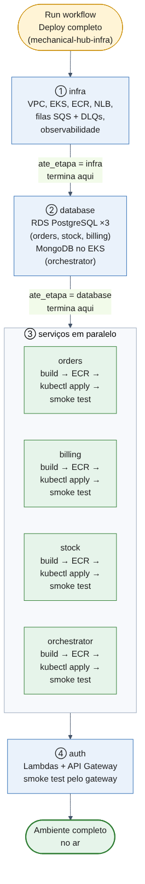

# Pipeline de deploy — guia de uso

Este guia explica, de forma simples, como o ambiente completo do Mechanical Hub é criado por **um único disparo** no GitHub Actions: o que é construído em cada etapa, como executar e o que significam as opções (checkboxes) da tela.

A decisão de arquitetura está na [ADR-0008](../../adr/ADR-0008-pipeline-de-deploy-unica.md).

## Visão geral

A pipeline se chama **Deploy completo** (arquivo `deploy-all.yml`) e vive no repositório `mechanical-hub-infra`. Ela não faz o trabalho sozinha: chama o `deploy.yml` de cada repositório, um após o outro, na ordem certa. Se uma etapa falha, as seguintes não rodam.

Fonte do diagrama: [`pipeline-diagram.mermaid`](pipeline-diagram.mermaid).

| Ordem | Etapa | Repositório | Roda quando |
|---|---|---|---|
| ① | `infra` | `mechanical-hub-infra` | sempre primeiro |
| ② | `database` | `mechanical-hub-database` | depois da `infra` |
| ③ | `orders`, `billing`, `stock`, `orchestrator` | um repositório por serviço | depois do `database`, **os quatro ao mesmo tempo** |
| ④ | `auth` | `mechanical-hub-auth` | depois dos quatro serviços |

## O que cada etapa constrói

### ① infra — a base
Cria o que todos os serviços usam:
- rede (VPC) e o cluster Kubernetes (EKS);
- um repositório de imagens (ECR) para cada serviço;
- o balanceador interno (NLB) e os target groups;
- as filas Amazon SQS (FIFO) com as respectivas DLQs;
- a stack de observabilidade (Grafana, Prometheus, Loki, Tempo e coletor OpenTelemetry).

### ② database — os bancos
- Três bancos PostgreSQL no RDS, um para cada serviço SQL: `orders`, `stock` e `billing`.
- O MongoDB do `orchestrator`, que roda dentro do cluster EKS.
- Os usuários de cada serviço e a role somente leitura usada pela Lambda de autenticação.

As tabelas e os índices são criados depois, pelas migrations de cada serviço, na etapa ③.

### ③ serviços — as aplicações
Os quatro serviços seguem os mesmos passos:
1. **Build e testes** (unitários, integração e BDD), mais análise de qualidade no SonarQube Cloud;
2. **Imagem** Docker construída e enviada ao ECR;
3. **Deploy no EKS** (`kubectl apply` dos manifestos e espera do rollout);
4. **Smoke test**: confere se o serviço subiu e está conversando com seu banco e com o SQS.

### ④ auth — a porta de entrada
- As Lambdas de autenticação (`authenticate` e `authorize`);
- o API Gateway, com as rotas para os serviços;
- um smoke test passando pelo gateway (`orders` e `billing`). Logo após o deploy, o gateway pode responder `5xx` por alguns minutos; o teste espera isso passar antes de falhar.

## Como executar

### Antes de começar
1. **Atualizar as credenciais do Lab.** A sessão do AWS Academy dura cerca de 4 horas. Em *Settings → Secrets and variables → Actions* da organização `mechanical-hub-fiap`, atualize `AWS_ACCESS_KEY_ID`, `AWS_SECRET_ACCESS_KEY` e `AWS_SESSION_TOKEN`. É em um lugar só: todos os repositórios herdam.
2. Conferir que os demais secrets da organização estão preenchidos (lista completa no README do `mechanical-hub-infra`, seção "Pipeline única").

### Disparar
1. Abra o repositório **`mechanical-hub-infra`** no GitHub.
2. Vá em **Actions** e escolha o workflow **Deploy completo**.
3. Clique em **Run workflow**, mantenha a branch `main`.
4. Preencha as opções (próxima seção) e confirme em **Run workflow**.
5. Acompanhe pela tela da execução. Cada etapa aparece como um job e cada job como um bloco do diagrama.

### Se algo falhar
- Abra o job que ficou vermelho e leia o log do passo com erro. Os jobs seguintes não rodam.
- Se for credencial expirada (`ExpiredToken`, `AccessDenied`), atualize os secrets e rode **Deploy completo** de novo. Rodar de novo é seguro: a pipeline pode ser repetida.
- Deploys de um mesmo ambiente não rodam em paralelo: um segundo disparo espera o primeiro terminar.

## Opções da tela (inputs e checkboxes)

| Opção | Tipo | Para que serve |
|---|---|---|
| `environment` | texto | Ambiente de destino. Use o valor padrão (`prod`), a menos que exista outro ambiente. |
| `ate_etapa` | lista: `infra`, `database`, `auth` | Até onde a pipeline vai. `infra` sobe só a base; `database` sobe a base e os bancos; `auth` sobe tudo (inclui os serviços e o gateway). |
| `mongodb_persistencia` | checkbox | **Marcado:** o MongoDB guarda os dados em disco (volume EBS) e sobrevive a reinício. **Desmarcado:** armazenamento temporário; ao recriar o pod, os dados do orquestrador são perdidos. |
| `criar_usuarios_e_role` | checkbox | **Marcado:** a etapa `database` cria os usuários de cada serviço e a role de leitura da Lambda. **Desmarcado:** pula essa criação. |

Como escolher:

| Situação | `ate_etapa` | `mongodb_persistencia` | `criar_usuarios_e_role` |
|---|---|---|---|
| Ambiente novo, do zero | `auth` | marcado | marcado |
| Retomar depois que a sessão do Lab expirou | `auth` | marcado | marcado (se os usuários já existem, não faz mal repetir) |
| Só testar a infraestrutura | `infra` | — | — |
| Testar infra e bancos, sem serviços | `database` | conforme o teste | marcado na primeira vez |

> **Atenção:** a descrição das opções acima foi escrita a partir do ADR-0008, da lista de tarefas e do `infrastructure.md`. Os valores padrão e o texto exato de cada checkbox ficam no `deploy-all.yml`, que não foi conferido na escrita deste guia. Se a tela mostrar algo diferente, vale a tela, e este trecho deve ser corrigido.

## Derrubar o ambiente

Ainda não existe pipeline de destroy; é manual. Alguns recursos cobram por hora mesmo sem uso (EKS, três instâncias RDS, NAT Gateway e NLB), então destrua o ambiente ao terminar o ciclo de trabalho. Rode `terraform destroy` na ordem inversa: `auth`, `database`, `infra`.

## Resumo rápido

1. Atualize as credenciais do Lab na organização.
2. `mechanical-hub-infra` → Actions → **Deploy completo** → Run workflow.
3. Em um ambiente novo: `ate_etapa = auth` e os dois checkboxes marcados.
4. Espere ficar tudo verde. Se falhar, leia o log do job vermelho, corrija e rode de novo.
5. Ao terminar, destrua o ambiente para não gastar crédito.
