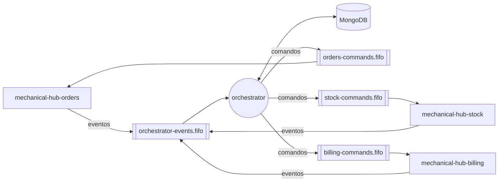
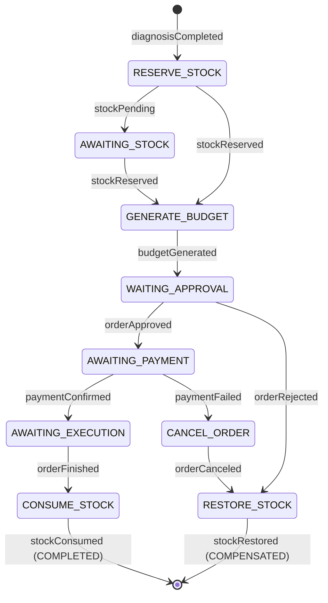

# mechanical-hub-orchestrator — Arquitetura

Descreve o que o serviço faz e como está construído. Regras de negócio detalhadas e o passo a passo de cada fluxo ficam nos documentos do sistema citados ao longo do texto (pasta [`docs/`](https://github.com/mechanical-hub-fiap/mechanical-hub-orchestrator/tree/main/docs) deste repositório).

## 1. Visão geral

O orquestrador conduz a saga de cada ordem de serviço do Mechanical Hub. Ele guarda o estado da saga, recebe os eventos de `orders`, `stock` e `billing`, decide o próximo passo e publica o comando para o serviço responsável, inclusive nas compensações. Não tem regra de negócio de domínio nem API para usuários: é dirigido apenas por mensagens.



## 2. Responsabilidades e fronteiras

**Dados que o serviço possui**

| Dado | Onde |
|---|---|
| Estado da saga de cada ordem (status, passo atual, `seq`, reparos, materiais reservados, orçamento, pagamento) | `transaction_register` |
| Trilha de todas as mensagens recebidas e o que foi feito com cada uma | `transaction_history` |
| Comandos ainda não publicados | `outbox_events` |

**O que ele não faz e quem faz**

| Assunto | Dono |
|---|---|
| Status da ordem, reparos, clientes, notificações e API do mecânico/cliente | `orders` |
| Saldo de materiais, reserva, baixa, devolução e pendências | `stock` |
| Preço, orçamento, cobrança e confirmação do pagamento no Mercado Pago | `billing` |
| Validação de cada passo (ex.: se a ordem pode ser aprovada) | o serviço que recebe o comando |

O orquestrador nunca chama os outros serviços por REST e não guarda dados pessoais do cliente; os comandos levam só identificadores e valores necessários ao passo.

## 3. Estrutura interna

Clean Architecture em três camadas, com dependências apontando sempre para dentro (`infrastructure → application → domain`):

| Pacote | Conteúdo | Pode depender de |
|---|---|---|
| `domain` | `SagaStateMachine` (tabela evento × passo → transição), modelos dos eventos e comandos, enums (`SagaStatusEnum`, `SagaStepEnum`, `TransactionOutcomeEnum`), exceções de domínio | nada (Kotlin puro) |
| `application` | Casos de uso (`ProcessSagaEventUseCase`, `RelayOutboxUseCase`, `GetTransactionUseCase`), handlers por evento, guarda de passo e portas (`SagaRepository`, `OutboxPort`, `TransactionHistoryPort`, `CommandPublisher`) | `domain` |
| `infrastructure` | Adapters MongoDB, listener e parser do SQS, contratos JSON versionados, relay do outbox, controller REST, métricas e configuração Spring | `application`, `domain` |
| `logging` | `FlowLog`: logs de etapa no formato do padrão de logs | — |

Componentes principais:

| Componente | Papel |
|---|---|
| `SagaEventListener` + `SagaEventMessageProcessor` | Recebem a mensagem da fila, classificam erros (transitório × permanente) e confirmam a mensagem só após o commit |
| `SagaEventDispatcher` | Encaminha cada `type` para o handler correspondente |
| `GuardedSagaEventHandler` / `DiagnosisCompletedHandler` | Aplicam a transição: guarda de passo, atualização da saga, histórico e outbox numa única transação |
| `SagaStateMachine` | Fonte única das transições permitidas (seção 5.3) |
| `OutboxRelayScheduler` + `SqsCommandPublisher` | Publicam os comandos pendentes em ordem de `seq` por ordem, só na instância líder (ShedLock) |
| `TransactionController` | Consulta operacional da saga |
| `SagaMetrics` / `OrchestratorGauges` | Contadores e gauges expostos no Prometheus |

## 4. Interface síncrona (REST)

O serviço não expõe API de negócio. As rotas abaixo são operacionais e não passam pelo API Gateway (acesso por `kubectl port-forward`), por isso não exigem os headers `x-user-*`.

| Método | Rota | Quem chama | Autenticação | Resposta / erros |
|---|---|---|---|---|
| GET | `/actuator/health/liveness`, `/actuator/health/readiness` | Kubernetes | — | `200`/`503`; a readiness inclui o MongoDB |
| GET | `/actuator/prometheus` | Prometheus | — | Métricas |
| GET | `/transaction/{orderId}` | Operação / demonstração | — | `200` com a saga e a `transaction_history` ordenada por `seq`; `404` sem saga; `400` com id inválido |

Collection Postman: [api/mechanical-hub-orchestrator.postman_collection.json](api/mechanical-hub-orchestrator.postman_collection.json).

## 5. Interface assíncrona (mensagens)

### 5.1 Envelope e convenções

Todas as mensagens são JSON em filas SQS FIFO, com o envelope:

| Campo | Descrição |
|---|---|
| `eventId` | Id único da mensagem; também é o `MessageDeduplicationId` |
| `transactionId` | Id da saga (gerado pelo orquestrador no `diagnosisCompleted`) |
| `orderId` | Id da ordem; também é o `MessageGroupId`, garantindo ordem por ordem de serviço |
| `type` | Nome do evento ou comando |
| `version` | Versão do contrato (`1`) |
| `timestamp` | Momento da emissão (ISO-8601, UTC) |

Todo comando publicado leva `idempotencyKey = {transactionId}:{STEP}`, usada pelo serviço de destino para deduplicar. O contexto de trace viaja nos *message attributes*. Os contratos ficam em `infrastructure/messaging/contracts`, como cópia local de cada serviço.

### 5.2 Filas

| Direção | Fila | DLQ |
|---|---|---|
| Lê | `mechanical-hub-orchestrator-events.fifo` | `mechanical-hub-orchestrator-events-dlq.fifo` |
| Escreve | `mechanical-hub-orders-commands.fifo`, `mechanical-hub-stock-commands.fifo`, `mechanical-hub-billing-commands.fifo` | de cada serviço |

### 5.3 Mensagens consumidas

Idempotência em todas: deduplicação por `messageKey = eventId` no índice único da `transaction_history`, mais a guarda de passo (o evento só é aplicado se a saga estiver no passo esperado).

| Tipo | Origem | Passo esperado | Payload relevante | Efeito no serviço |
|---|---|---|---|---|
| `diagnosisCompleted` | orders | — (cria a saga) | `repairs[{repairId}]` | Cria a saga `STARTED` em `RESERVE_STOCK`; repetido esbarra no índice único de `orderId` e é descartado |
| `stockPending` | stock | `RESERVE_STOCK` | — | `AWAITING_STOCK` |
| `stockReserved` | stock | `RESERVE_STOCK` ou `AWAITING_STOCK` | `reservedMaterials[{materialId, quantity}]` | Grava os materiais e vai para `GENERATE_BUDGET` |
| `budgetGenerated` | billing | `GENERATE_BUDGET` | `budgetId`, `orderCost` | Grava o orçamento; `WAITING_APPROVAL` |
| `orderApproved` | orders | `WAITING_APPROVAL` | — | `AWAITING_PAYMENT` |
| `orderRejected` | orders | `WAITING_APPROVAL` | — | `COMPENSATING`; `RESTORE_STOCK` |
| `paymentLinkGenerated` | billing | `AWAITING_PAYMENT` sem link gravado | `paymentLink`, `expiresAt` | Grava o link (não muda o passo) |
| `paymentConfirmed` | billing | `AWAITING_PAYMENT` | `paymentId` | `AWAITING_EXECUTION` |
| `paymentFailed` | billing | `AWAITING_PAYMENT` | `reason` (`EXPIRED`/`FAILED`) | `COMPENSATING`; `CANCEL_ORDER` |
| `orderCanceled` | orders | `CANCEL_ORDER` | — | `RESTORE_STOCK` |
| `orderFinished` | orders | `AWAITING_EXECUTION` | — | `CONSUME_STOCK` |
| `stockConsumed` | stock | `CONSUME_STOCK` | — | Fim: `COMPLETED` |
| `stockRestored` | stock | `RESTORE_STOCK` | — | Fim: `COMPENSATED` |



### 5.4 Mensagens publicadas

Sempre via outbox, na mesma transação da atualização da saga.

| Tipo | Fila | Payload adicional | Quando é emitida |
|---|---|---|---|
| `reserveStock` | stock | `repairs[{repairId}]` | `diagnosisCompleted` |
| `markStockPending` | orders | — | `stockPending` |
| `clearStockPending` | orders | — | `stockReserved` vindo de `AWAITING_STOCK` (antes do `generateBudget`) |
| `generateBudget` | billing | `repairs`, `reservedMaterials` | `stockReserved` |
| `sendApproval` | orders | `budgetId`, `orderCost` | `budgetGenerated` |
| `generatePaymentLink` | billing | `budgetId`, `orderCost` | `orderApproved` |
| `sendPaymentLink` | orders | `paymentLink` | `paymentLinkGenerated` |
| `releaseOrder` | orders | — | `paymentConfirmed` |
| `cancelOrder` | orders | `reason = PAYMENT_NOT_CONFIRMED` | `paymentFailed` |
| `consumeStock` | stock | `reservedMaterials` (lido da saga) | `orderFinished` |
| `restoreStock` | stock | `reservedMaterials` (lido da saga) | `orderRejected`, `orderCanceled` |

## 6. Modelo de dados

MongoDB 7 em replica set (exigido para transações multi-documento), provisionado pelo `mechanical-hub-database`. Escolhido por ser o único serviço sem relacionamentos fortes: cada saga é um documento que cresce a cada passo ([ADR-0004](https://github.com/mechanical-hub-fiap/mechanical-hub-orchestrator/blob/main/docs/adr/ADR-0004-banco-de-dados-por-microsservico.md)).

| Coleção | Conteúdo | Índices |
|---|---|---|
| `transaction_register` | Um documento por saga: `_id = transactionId`, `orderId`, `status`, `currentStep`, `seq`, `repairs`, `reservedMaterials`, `budget`, `payment`, `createdAt`, `updatedAt`, `finishedAt` | `orderId` único; `{status, currentStep, updatedAt}` para achar sagas paradas |
| `transaction_history` | Append-only: `transactionId`, `orderId`, `seq`, `messageType`, `messageKey`, `stepBefore`, `stepAfter`, `outcome` (`APPLIED`, `DISCARDED_STEP_GUARD`…), `receivedAt` | `messageKey` único; `{orderId, seq}`; `{messageType, receivedAt}` |
| `outbox_events` | `_id = eventId`, `orderId`, `seq`, `eventType`, `payload`, `status` (`PENDING`/`SENT`), `attempts`, `lastError`, `createdAt`, `sentAt` | `{status, createdAt}`; `{orderId, seq}` único |
| `shedLock` | Lease de liderança do relay | — |

- **Inbox:** a `transaction_history` faz o papel da `inbox_events` dos outros serviços.
- **Limpeza:** as três coleções são permanentes, sem job de limpeza; a trilha é a auditoria da saga.
- **Migrations:** não há catálogo nem seeds; todo dado nasce das mensagens. Os índices são criados pelo próprio serviço na subida (`MongoIndexInitializer`), e a aplicação falha se não conseguir criá-los.
- `writeConcern` e `readConcern` `majority`, transações em `snapshot`, `readPreference: primary`, fixados no `MongoConfig`.

## 7. Consistência e tratamento de falhas

- **Atomicidade:** cada evento é processado numa transação multi-documento: deduplicação → guarda de passo (`findOneAndUpdate` filtrando `currentStep`, com `$inc: { seq: n }`) → `transaction_history` (`APPLIED`) → `outbox_events` → `commitTransaction`. Só depois a mensagem é apagada da fila.
- **Duplicada:** o mesmo `eventId` esbarra no índice único da `transaction_history` e é ignorado.
- **Fora de ordem:** evento num passo diferente do esperado aborta a transação, grava só a linha `DISCARDED_STEP_GUARD` e confirma a mensagem (log `INFO`, não é erro). Cobre também o `stockReserved` de outras ordens gerado pela redistribuição do `restoreStock`.
- **Retry:** erro transitório (`TransientTransactionError`, `WriteConflict`, `NotWritablePrimary`, `UnknownTransactionCommitResult`, timeout) não apaga a mensagem e ajusta o *visibility timeout* pela `ApproximateReceiveCount` (1 s → 8 s). Após 6 recebimentos o SQS move a mensagem para a DLQ.
- **DLQ:** erro permanente (JSON inválido, `type` desconhecido, campo fora do contrato) vai direto à DLQ com os atributos `errorClass` e `errorMessage`. O reprocessamento é pelo redrive nativo do SQS e é seguro graças à deduplicação e à guarda de passo (seção 7.1).
- **Outbox:** relay a cada 1 s, lotes de 100 por `createdAt`; por `orderId` publica em ordem de `seq` e não publica o `seq` n+1 enquanto o n estiver `PENDING`. Erro interrompe o lote e grava `attempts` + `lastError`.
- **Compensações:** o orquestrador é quem as conduz. Orçamento recusado → `restoreStock`. Pagamento não confirmado → `cancelOrder` → `restoreStock`. A saga termina em `COMPENSATED`.

### 7.1 Reprocessar a DLQ

Qualquer mensagem na DLQ dispara o alarme do CloudWatch (módulo `sqs` do `mechanical-hub-infra`) e aparece no painel da saga. Procedimento ([`failure_handling.md`](https://github.com/mechanical-hub-fiap/mechanical-hub-orchestrator/blob/main/docs/design/failure_handling.md) §3.3):

1. Ler a mensagem e o motivo (`errorClass`/`errorMessage`; erros transitórios esgotados chegam sem esses atributos):
   ```bash
   aws sqs receive-message --queue-url "$DLQ_URL" --max-number-of-messages 10 \
     --message-attribute-names All --attribute-names All --visibility-timeout 0
   ```
2. Conferir a saga da ordem em `GET /transaction/{orderId}`.
3. Corrigir a causa (deploy de correção ou ajuste no serviço que publicou fora do contrato).
4. Devolver as mensagens à fila de origem (console do SQS → *Start DLQ redrive*, ou):
   ```bash
   aws sqs start-message-move-task --source-arn "$DLQ_ARN" --destination-arn "$EVENTS_QUEUE_ARN"
   ```

A retenção da DLQ é de 14 dias. URLs e ARNs vêm dos outputs `sqs_dlq_urls`, `sqs_queue_urls` e `sqs_queue_arns` do `mechanical-hub-infra`.

## 8. Observabilidade

- **Logs:** JSON (Logstash encoder) com mensagem em logfmt conforme o [padrão de logs](https://github.com/mechanical-hub-fiap/mechanical-hub-orchestrator/blob/main/docs/engineering/logging-standard.md): `orderId`, `status` (passo da saga), `stage` (`START`/`END`/`FAIL`), `attempt`, `durationMs`; no JSON também `service`, `transactionId`, `eventId`, `currentStep`, `trace_id`, `span_id`.
- **Métricas** (`/actuator/prometheus`): `saga_started_total`, `saga_finished_total{status}`, `saga_messages_total{type, outcome}`, `saga_active{current_step}`, `outbox_oldest_pending_age_seconds` (alerta acima de 60 s).
- **Traces:** agente OpenTelemetry; o contexto chega pelos *message attributes* do SQS e é propagado nos comandos publicados pelo relay, ligando o trace de ponta a ponta entre os serviços.
- **Painel:** *Mechanical Hub — Saga* no Grafana (sagas por passo, compensações, descartes, outbox pendente, profundidade das filas e DLQs) e alarme de DLQ > 0 no CloudWatch.

## 9. Decisões e limitações

Decisões relacionadas:

- [RFC-0005 — Saga orquestrada](https://github.com/mechanical-hub-fiap/mechanical-hub-orchestrator/blob/main/docs/rfc/RFC-0005-saga-orquestrada.md)
- [ADR-0004 — Banco de dados por microsserviço](https://github.com/mechanical-hub-fiap/mechanical-hub-orchestrator/blob/main/docs/adr/ADR-0004-banco-de-dados-por-microsservico.md)
- [ADR-0005 — Divisão em microsserviços](https://github.com/mechanical-hub-fiap/mechanical-hub-orchestrator/blob/main/docs/adr/ADR-0005-divisao-em-microsservicos.md)
- [ADR-0006 — Comunicação híbrida](https://github.com/mechanical-hub-fiap/mechanical-hub-orchestrator/blob/main/docs/adr/ADR-0006-comunicacao-hibrida.md)
- [ADR-0007 — Outbox e inbox](https://github.com/mechanical-hub-fiap/mechanical-hub-orchestrator/blob/main/docs/adr/ADR-0007-outbox-e-inbox.md)
- [Status e passos da saga](https://github.com/mechanical-hub-fiap/mechanical-hub-orchestrator/blob/main/docs/design/saga_transaction_status.md) e [tratamento de falhas](https://github.com/mechanical-hub-fiap/mechanical-hub-orchestrator/blob/main/docs/design/failure_handling.md)
- Fluxos: [ordem completa](https://github.com/mechanical-hub-fiap/mechanical-hub-orchestrator/blob/main/docs/design/distributedTransaction/td_finished_os.md), [pendência de estoque](https://github.com/mechanical-hub-fiap/mechanical-hub-orchestrator/blob/main/docs/design/distributedTransaction/td_stock_pending.md), [orçamento recusado](https://github.com/mechanical-hub-fiap/mechanical-hub-orchestrator/blob/main/docs/design/distributedTransaction/td_budget_refused.md), [pagamento não confirmado](https://github.com/mechanical-hub-fiap/mechanical-hub-orchestrator/blob/main/docs/design/distributedTransaction/td_payment_failed.md)

Fora do escopo por enquanto (requisitos futuros):

- Prazo máximo em `AWAITING_STOCK` e compensação automática de sagas paradas (FR-01). Hoje elas são localizadas pelo índice `status + currentStep + updatedAt` e pelo painel.
- Ajuste de reparos ou de orçamento depois do início da saga (FR-02 e seguintes).
- Endpoint público de consulta da saga; a rota `/transaction/{orderId}` existe só para operação.
